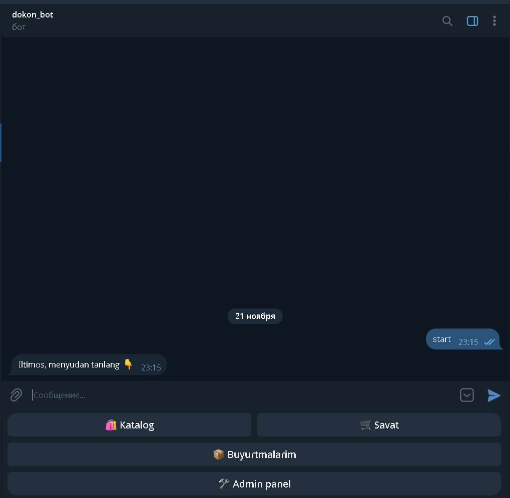
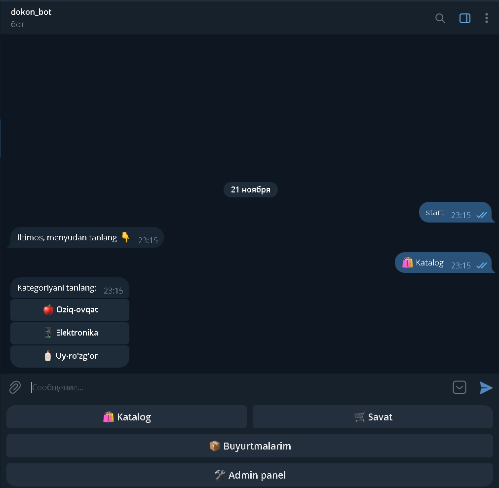
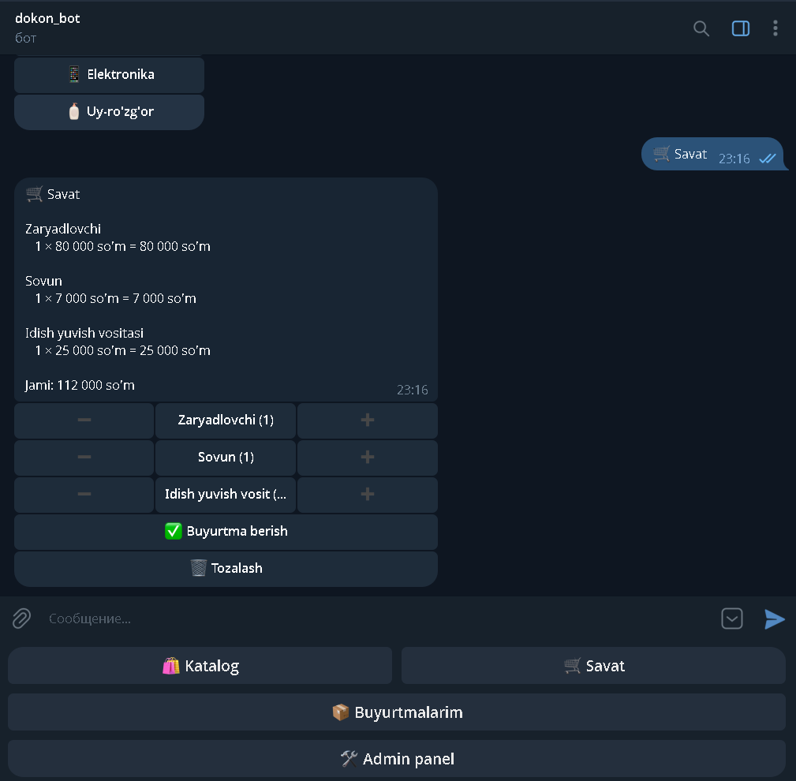
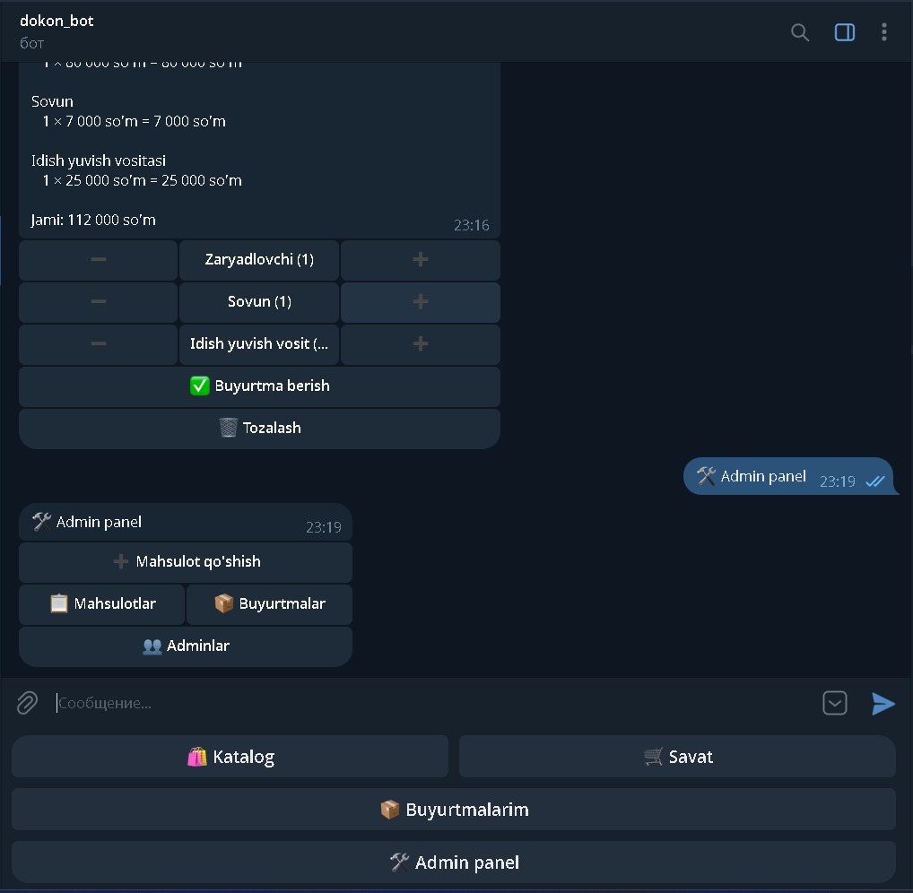

# 🛒 Shop Bot

Telegram do'kon boti: katalog, savat, buyurtma berish va ko'p adminli boshqaruv paneli.

## Imkoniyatlar

**Mijoz uchun**
- 🛍 Kategoriyalar va mahsulotlar (rasm, narx, tavsif)
- 🛒 Savat: miqdorni o'zgartirish, tozalash
- 📝 Buyurtma berish: ism, telefon, manzil
- 📦 Buyurtmalar tarixi va holat xabarlari

**Admin uchun**
- 🔔 Yangi buyurtma barcha adminlarga xabar bo'lib keladi
- ✅ Buyurtma holatini o'zgartirish (qabul qilindi, yetkazildi, bekor)
- ➕ Mahsulot qo'shish va o'chirish (admin panel)
- 👥 Asosiy admin boshqa adminlarni qo'shadi va o'chiradi

## Texnologiyalar

Python 3.12, aiogram 3 (FSM), SQLite

## O'rnatish

1. Loyihani yuklab oling:
   ```
   git clone https://github.com/zaripovabdulaz-code/shop-bot.git
   cd shop-bot
   pip install -r requirements.txt
   ```
2. `.env.example` ni `.env` deb nusxalang va to'ldiring:
   ```
   BOT_TOKEN=@BotFather bergan token
   ADMIN_ID=sizning Telegram ID'ingiz
   ```
3. Ishga tushiring:
   ```
   python bot.py
   ```

## Buyruqlar

| Buyruq | Kim uchun | Vazifasi |
|---|---|---|
| `/start` | Hamma | Boshlash |
| `/id` | Hamma | Telegram ID |
| `/cancel` | Hamma | Jarayonni bekor qilish |
| `/admin` | Adminlar | Admin panel |
| `/addadmin ID` | Asosiy admin | Admin qo'shish |
| `/deladmin ID` | Asosiy admin | Adminni o'chirish |
| `/admins` | Asosiy admin | Adminlar ro'yxati |

## Skrinshotlar

## Skrinshotlar

<p>
  
  
  
  
</p>

## Muallif

Abdulaziz: [GitHub](https://github.com/zaripovabdulaz-code)